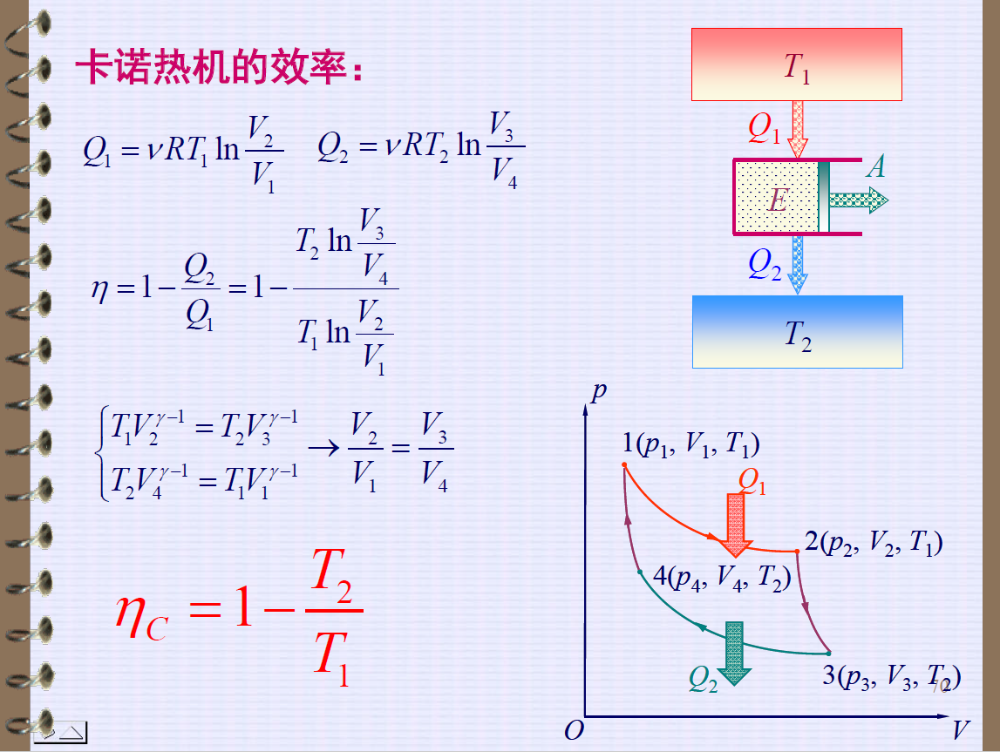

## 第五章

### 功

$$
\mathrm d A = F \mathrm dl = pS \mathrm d l = - p \mathrm d V \\
\int \mathrm d A = \int - p \mathrm d V \\
A = -\int_{V_1}^{V_2} p \mathrm d V
$$

### 热力学第一定律

$$
\Delta U = A + Q
$$

### 热容

热容：使物质温度升高 $1$ 度所需的热量称为热容：
$$
C = \lim_{\Delta T \to 0} \frac{\Delta Q}{\Delta T}
$$
摩尔热容：使 $1 \text{mol}$ 物质温度升高 $1$ 度所需的热量称为摩尔热容：
$$
C_m = \frac{1}{\nu}\lim_{\Delta T \to 0} \frac{\Delta Q}{\Delta T}
$$
定容（摩尔）热容：在上面的概念中加上 " 通过定容过程 "：
$$
V \text{ unchanged} \to A = 0 \\
\Delta U = \Delta Q \\
C_{V, m} = \frac{1}{\nu}\lim_{\Delta T \to 0} \frac{\Delta U}{\Delta T} = 
\frac{1}{\nu} \left(\frac{\partial U}{\partial T}\right)_V
$$
定压（摩尔）热容：在上面的概念中加上 " 通过定压过程 "：
$$
C_{p, m} = \frac{1}{\nu}\lim_{\Delta T \to 0} \frac{\Delta Q_p}{\Delta T} = \frac{1}{\nu}\lim_{\Delta T \to 0} \frac{\Delta H}{\Delta T}
$$
焓：
$$
\Delta Q_p = \Delta U - \Delta A = \Delta U + p\Delta V = \Delta (U + pV)_p \\
H \equiv U + pV \\
\Delta Q_p = \Delta H
$$

### 理想气体内能和热容

理想气体中，内能只是温度的函数，即：
$$
U = U(T)
$$
考虑之前的式子：
$$
C_{V, m} = 
\frac{1}{\nu} \left(\frac{\mathrm d U}{\mathrm d T}\right) = C_{V, m}(T) \\
\mathrm d U = \nu C_{V, m} \mathrm d T \\
\int \mathrm d U = \int \nu C_{V, m} \mathrm d T \\
\text{When } C_{V, m} \text{= const. then } \Delta U = \nu C_{V, m} (T_2 - T_1)
$$

在定压情况下，$H$ 也只是温度 $T$ 的函数，故同理有：
$$
\int \mathrm d H = \int \nu C_{p, m} \mathrm d T \\
\text{When } C_{p, m} \text{= const. then } \Delta H = \nu C_{p, m} (T_2 - T_1)
$$

### 理想气体 $C_{V, m}$ 和 $C_{p, m}$ 的关系（迈耶公式）

$$
H_m = U_m + pV_m = U_m + RT \\
C_{p, m} = \lim_{\Delta T \to 0} \frac{\Delta H_m}{\Delta T} = \frac{\mathrm d U_m}{\mathrm d T} + R = C_{V, m} + R
$$

### 几个过程（求 $\Delta U$、$A$、$Q$）

#### 等容过程

$$
\Delta U = \nu C_{V, m} (T_2 - T_1)\\
A = 0 \\
Q = \Delta U = \nu C_{V, m} (T_2 - T_1)
$$

#### 等压过程

$$
\Delta U = \nu C_{V, m} (T_2 - T_1)\\
A = -p(V_2-V_1) = -\nu R(T_2 - T_1)\\
Q = \Delta U - A = \nu C_{p, m} (T_2 - T_1)
$$

#### 等温过程

$$
\Delta U = 0 \\
A = -\int_{V_1}^{V_2}p\mathrm d V =
-\int_{V_1}^{V_2}\frac{\nu R T}{V}\mathrm d V = -\nu R T \ln \frac{V_2}{V_1} \\
Q = -A = \nu R T \ln \frac{V_2}{V_1}
$$

#### 绝热过程

$$
\mathrm d U = -p \mathrm d V + \mathrm d Q \\
\mathrm d Q = 0, \mathrm d U = \nu C_{V, m}\mathrm d T \\
pV = \nu R T \to \mathrm d T = \frac{1}{\nu R}\left( p \mathrm d V + V \mathrm d p\right) \\
$$

联立上式，消去 $T$：
$$
\frac{\mathrm d p}{p} = - \frac{C_{p, m}}{C_{V, m}}\frac{\mathrm d V}{V} \\
\text{Let } \gamma = \frac{C_{p, m}}{C_{V, m}}, \frac{\mathrm d p}{p} = -\gamma \frac{\mathrm d V}{V} \\
V \mathrm d p + \gamma p \mathrm d V = 0 \\
\mathrm d \left( pV^{\gamma}\right) = 0 \\
\text{explain : } \\
p \gamma V^{\gamma - 1} \mathrm d V + V^\gamma \mathrm d p = 0 \\
\gamma  p \mathrm d V + V\mathrm d p = 0
$$

故：
$$
pV^{\gamma} = C
$$
如果画 $p$ - $V$ 图像，就会有两种线，分别是等温线和绝热线，分别满足：
$$
pV =C \\
pV^\gamma =  C
$$

$$
\Delta U = \nu C_{V, m}(T_2 - T_1)\\
A = \nu C_{V, m}(T_2 - T_1)\\
Q = 0
$$

#### 多方过程

满足：
$$
pV^n = C
$$
其中 $n$ 为常数。

容易发现，以上四个过程都可以通过给 $n$ 取某值来确定。

求摩尔热容 $C_{m}$：
$$
\mathrm d U = \mathrm d Q + \mathrm d A \\
\nu C_{V, m} \mathrm d T = \nu C_{m} \mathrm d T -p \mathrm d V \\
pV^n = C \to np \mathrm d V + V\mathrm d p = 0 \\
pV = \nu R T \to p \mathrm d V + V \mathrm d p = \nu R \mathrm d T \\
\text{So : } p\mathrm d V = \frac{\nu R \mathrm d T}{1 - n} \\
C_m = C_{V, m} - \frac{R}{n - 1} = C_{V, m} \frac{n - \gamma}{n - 1}
$$

### 热机效率

$Q_1$ : 吸热过程所吸收的热量；

$Q_2$ : 放热过程所放出的热量；

由热力学第一定律，$\Delta U = A + Q_1 - Q_2$，热机全过程 $\Delta U = 0$，故 $|A| = Q_1 - Q_2$。

故：
$$
\eta = \frac{|A|}{Q_1} = 1 - \frac{Q_2}{Q_1}
$$

### 卡诺循环

等温 + 绝热 + 等温 + 绝热。

经过推导，可得：
$$
\eta = 1 - \frac{T_2}{T_1}
$$

### 热机和制冷剂

热机从高温热源捕获热量（总体呈现吸热），一部分用于对外做功，一部分以热能的形式传导给低温热源；

外界对制冷机做功（总体呈现放热），使制冷机从低温热源捕获热量，并将热量传递给高温热源。

制冷系数：
$$
\epsilon = \frac{Q_2}{A} = \frac{Q_2}{Q_1 - Q_2}
$$
$Q_1$ : 放热过程所放出的热量；

$Q_2$ : 吸热过程所吸收的热量；
