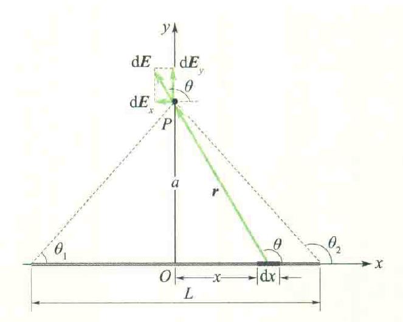
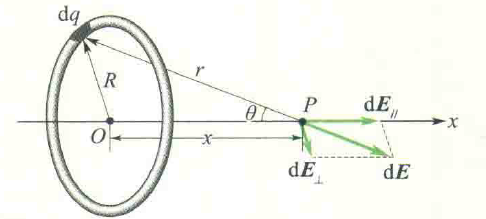

# 写在前面

$$
k = \frac{1}{4 \pi \epsilon_0} \approx 9.0 \times 10^9
$$

# 静电场

### 库伦定律

$$
F = k \frac{q_1 q_2}{r^2} = \frac{1}{4 \pi \epsilon_0} \frac{q_1q_2}{r^2}
$$

### 电场强度

$$
E = \frac{F}{q_0}
$$

**点电荷电场强度：**
$$
E = \frac{1}{4 \pi \epsilon_0} \frac{q}{r^2}
$$
**带电直线的电场分布：**

$$
E_x = \frac{\lambda}{4 \pi \epsilon_0a} (\sin \theta_2 - \sin \theta_1) \\
E_y = \frac{\lambda}{4 \pi \epsilon_0a} (\cos \theta_1 - \cos \theta_2)
$$
 其中，$\lambda = \dfrac{q}{L}$；若直线无限长，则 $\theta_1 \to 0, \theta_2 \to \pi$，则：
$$
E_x = 0 \\
E_y = \frac{q}{2 \pi \epsilon_0 a L}
$$
**带电圆环在中心轴线上的电场强度分布：**

$$
E = \frac{qx}{4\pi\epsilon_0(R^2+x^2)^{3/2}}
$$
**带电圆盘在中心轴线上的电场强度分布：**

圆盘看作多个圆环的叠加。
$$
E = \int_0^R \frac{\sigma x 2\pi R\mathrm d R}{4\pi\epsilon_0(R^2+x^2)^{3/2}} = \frac{\sigma}{2 \epsilon_0}\left(1 - \frac{x}{\sqrt{R^2+x^2}} \right)
$$
**无限大带电平面的电场强度分布：**

即 $R \to +\infty$，$E = \dfrac{\sigma}{2\epsilon_0}$。

### 电通量

$$
\Phi = E \cdot S
$$

### 高斯定理

$$
\oint_SE \mathrm dS = \frac{\sum q_i}{\epsilon_0}
$$

求解对称的电场强度非常好用，例如球体内外场强。

**均匀带电球面的电场分布：**

球面半径为 $R$，带电量为 $q$。

球体内部（$r \leq R$）：
$$
\sum q_i = 0 \Rightarrow E = 0
$$
球体外部（$r > R$）：
$$
\sum q_i = q \\
S = 4 \pi r^2 \\
E = \frac{q}{4 \pi r^2 \epsilon_0}
$$
**均匀带电球体的电场分布：**

球面半径为 $R$，带电量为 $q$。

球体内部（$r \leq R$）：
$$
\sum q_i = q \dfrac{\frac{4}{3} \pi r^3}{\frac{4}{3} \pi R^3} = q \frac{r^3}{R^3} \\
S = 4 \pi r^2 \\
E = \frac{q r}{4 \pi \epsilon_0R^3}
$$
球体外部（$r > R$）：
$$
\sum q_i = q \\
S = 4 \pi r^2 \\
E = \frac{q}{4 \pi r^2 \epsilon_0}
$$

### 电势

点电荷电势：
$$
\varphi = \frac{q}{4\pi \epsilon_0} \frac{1}{r}
$$

均匀带电球面的电场中电势分布：

球面外一点（$r \geq R$）：
$$
U = \int_r^\infty \frac{q}{4 \pi \epsilon_0 r^2} \mathrm d r = \frac{q}{4 \pi \epsilon_0 r}
$$
球面内一点（$r < R$）：
$$
U = \frac{q}{4 \pi \epsilon_0R}
$$

### 静电场的环路定理

$$
\oint_l E \mathrm d l =0
$$

## 导体

导体以外，靠近导体表面附近的电场强度与导体表面在该处的面电荷密度 $\sigma$ 的关系：
$$
E = \frac{\sigma}{\epsilon_0}
$$

### 电极化强度

$$
\vec P = (\epsilon_r - 1) \epsilon_0 \vec E
$$

### 极化电荷面密度

$$
P = \sigma' = \frac{\epsilon_r - 1}{\epsilon_r}\sigma_0 \\
Q' = \frac{\epsilon_r - 1}{\epsilon_r}Q_0
$$

### 电位移矢量

$$
\vec D = \epsilon\vec E = \epsilon_r \epsilon_0 \vec E
$$

### 介质中的高斯定理

$$
\oint_S \vec D \cdot \mathrm d \vec S = \sum q
$$

通常做法：

有电介质，求 $\vec D$，再求 $\vec E$，再求 $U$。
